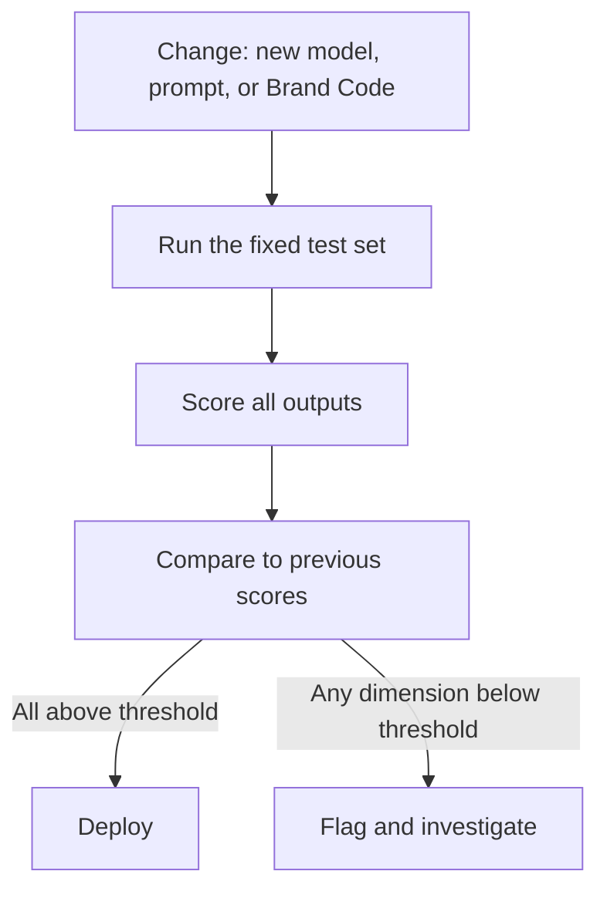
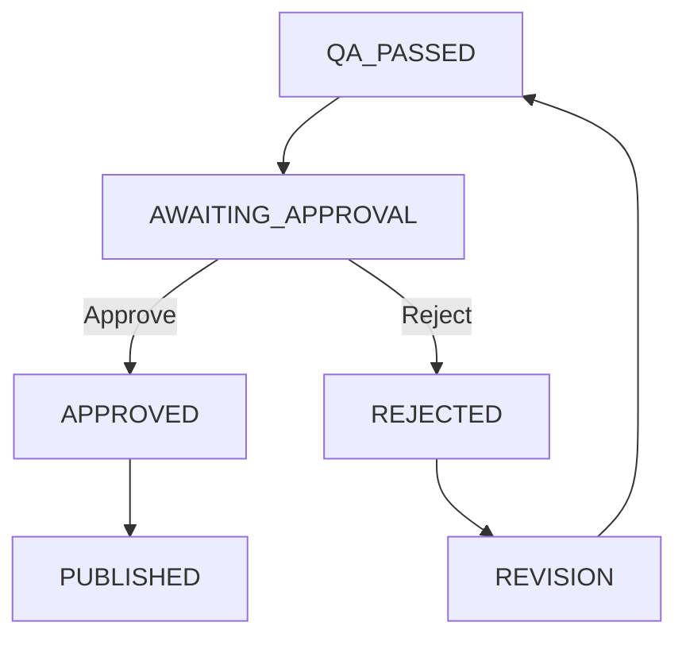

# AWS ISV ABM Content Workflow

## An AI-powered, brand-governed content workflow for AWS ISV Marketing

---

## 1. Executive Summary

Keeping brand consistency across dozens of campaigns, four distinct audiences, and multiple channels is hard. When content volume grows, small deviations from brand guidelines start compounding. Compliance reviews become bottlenecks. Creative teams spend more time policing output than producing it. And as campaigns scale, the gap between what the brand guidelines say and what actually ships keeps getting wider.

This document proposes a **Slack-based, human-approved AI workflow** built around four ideas:

- **Brand Code**: the AWS brand rules, turned into structured, machine-readable rules that the system can actually enforce. Derived from the ISV Playbook.
- **Product Knowledge**: approved product facts and claims that the system is allowed to use. Every fact traces back to its source.
- **Agents**: five specialised AI agents that turn a marketer's plain-language request into tailored campaign content for multiple audiences and channels.
- **Governance**: automated checks, AI review, and human approval. Nothing ships without a human saying yes. Everything is traceable.

The central design principle:

> **Use AI where judgment and writing are needed. Use code wherever a brand rule has a clear right or wrong answer. We are not trying to prompt the AI into writing better AWS copy. We are building a system that makes on-brand content the default path, and stops off-brand content before it can be published.**

The system works by first generating structured content (headlines, body copy, CTAs), then assembling it into approved templates, running automated compliance checks, and only publishing after the marketer explicitly approves.

---


## 2. Problem & Design Goals


### The problem

The AWS ISV Marketing team runs account-based marketing campaigns aimed at executives inside software companies. These campaigns target four distinct audiences, each requiring tailored messaging across multiple channels. Today, this process is:

- **Slow.** Producing persona-tailored content across channels requires coordination between multiple teams and agencies.
- **Inconsistent.** Brand drift accumulates across campaigns, channels, and markets.
- **Unscalable.** Scaling output means scaling headcount or accepting lower quality.
- **Hard to govern.** Tracing a published output back to its inputs, approvals, and brand rules is manual and fragile.


### Design goals


| #   | Goal                 | Requirement                                                                                     |
| --- | -------------------- | ----------------------------------------------------------------------------------------------- |
| 1   | Marketer-initiated   | A marketer kicks off a campaign with a plain-language request in Slack                          |
| 2   | Multi-channel        | Email and landing page output                                                                   |
| 3   | Multi-audience       | Output tailored per audience, per channel                                                       |
| 4   | Factually grounded   | No invented claims, facts, or product capabilities                                              |
| 5   | Visually compliant   | Output aligns with the ISV Playbook's visual system                                             |
| 6   | Personalised visuals | Each variant includes approved visual assets from the AWS DAM                                   |
| 7   | Human-approved       | Explicit marketer approval before anything ships                                                |
| 8   | CRM-ready            | Approved emails land in the CRM, ready for campaign send                                        |
| 9   | Conversational       | Marketer sees progress and previews in the same conversation                                    |
| 10  | Traceable            | Brand compliance stakeholders can trace any output back to its inputs, revisions, and approvals |


### Design principles

**1. Brand rules are higher authority than examples.**

The AWS ISV Playbook is the authoritative ruleset for this engagement. The supplied production email is useful as an implementation reference, but does not override the playbook. Where they conflict, the playbook wins. The system records the discrepancy rather than silently copying it forward.

**2. Never invent product facts.**

A model's general knowledge is never treated as product truth. Product claims must come from an approved Product Knowledge source. If the product is not in the system, the workflow stops and asks. It does not guess.

**3. AI handles judgment calls. Code handles exact rules.**

Some checks have a clear right or wrong answer; use code for those. Some checks require taste and judgment; use AI for those. The final call always belongs to a human.


| Check                              | Who handles it    |
| ---------------------------------- | ----------------- |
| Logo size ≥ 155px                  | Code (exact rule) |
| Color in approved palette          | Code (exact rule) |
| Asset marked as approved in DAM    | Code (exact rule) |
| HTML structure matches template    | Code (exact rule) |
| Required footer elements present   | Code (exact rule) |
| All claims link to approved source | Code (exact rule) |
| Audience relevance of message      | AI (judgment)     |
| Tone match for persona             | AI (judgment)     |
| Overall brand feel and quality     | AI (judgment)     |
| Final release decision             | Human             |


> **If a rule can be checked by code, we check it with code. We do not leave exact rules to AI judgment.**

**4. The AI writes the words. Code builds the page.**

The AI produces structured content (headlines, body paragraphs, CTA text). Then a template-based renderer turns that into email HTML or a landing page using approved, pre-built components. The AI never writes raw HTML directly.

**5. Nothing ships without human approval.**

No customer-facing content can reach the CRM or publishing system without the marketer explicitly saying yes. This is enforced by the system's architecture. Not by asking the AI to be careful, but by making it physically impossible for content to bypass the approval step.

**6. Everything is versioned and traceable.**

Every output is tied to the exact Brand Code version, Product Knowledge version, claims used, template version, model version, prompt version, and approval history. Six months later, a compliance stakeholder can reproduce exactly what happened and why.

---


## 3. Proposed Architecture


### Overview

The system uses **5 specialised AI agents**, **rule-based services**, and a **workflow controller**.

The agents exist because some jobs need judgment (such as writing copy or evaluating tone). Code-based services exist because some jobs should not need judgment (such as checking whether a logo is the right size). The workflow controller exists because the process itself is predictable. We already know the steps: understand the request, plan the message, write the content, pick visuals, build the page, check quality, get approval, publish. There is no reason to let an AI randomly reorder those steps.

### Why a fixed workflow, not an autonomous one

The process is predictable:

```
Understand request → Plan message → Write content → Pick visuals → Build page → Check quality → Get approval → Publish
```

We already know this sequence. Letting an AI decide the order would be risky, because the cost of getting it wrong is off-brand content reaching to a mass amount of people.

The rule is simple:

- **AI = makes judgment calls inside each step** (what to write, which image fits, whether the tone is right)
- **Workflow controller = decides what step happens next** (always the same sequence, always with approval before publishing)

We build the orchestrator as a **state machine**: a fixed sequence where each step leads to the next, and every campaign's progress is saved. Three reasons:

1. **Structured workflow.** Each step leads to the next in a defined order. No step is skipped, and no step runs before its inputs are ready.
2. **Built-in human approval.** The workflow can pause at any point, send a preview to the marketer, wait for their decision, and then continue. This is built into the architecture, not bolted on.
3. **Automatic state saving.** The orchestrator saves the state of every campaign as it progresses, which gives us the audit trail we need (requirement 10).

Why not a "supervisor agent" that lets AI agents talk to each other freely and decide what to do next? Because this workflow is *controlled*, not *autonomous*. The marketer needs to stay in charge. Letting agents decide among themselves what to do next would be a liability in a system that needs brand governance.

### System diagram

The system diagram is on mermaid.live so it renders consistently. Read it **left to right**.

**[Open the system diagram](https://mermaid.live/view#pako:eNqNVl1T6zYQ_Ssaz_BUSEkC3Bke2nGcUBgwCXZu6J26D4qtJJo4kivLoWnIf--u7EusxDDhAfDZXe3q7Je2TiwT5tw6Z2dbLri-JdvImaXyLV5QpSPHfC_0Kn2iU5bmCGhVsHMSOXGh1gyByEm5YFRFDsICzgszGnMxR2H7CkFFxbIGdm8QzGiS_NS63O12Z2eR-HBNnoJIRILAT15M54pmC_L4PHz9K3LcFJRYQpZCvqUsmUMQf5ea-JNwxWLNpSDj3h7teWDYgzAS4kGAlsXoEWQjJZMi1uSx8VDvCVS8lPJVTgI257lWG0th8CcoDP6lqyxl5IlPFT1QGI_wCDfLlFxD7GMGmlSz_EOJieTowmEbbNot8kMWhObLE-7pg0GY0nhJFPunYLm2bIYgHap4AbiiWipL6JOLi9_I8ItoOmDeaZHvImEq18DlKcS7hnjOZsSdM2HH89Le7pnHdIrfI2e3l4fj4QhZy5dkI4sWCbXMWtYJvTtMDNBO-VyQKfqx5a651Uu77hSh9x8sfwfzI_xZvhu_X_DQBZ_dFhmlVJzAQIgMhEg4m28aSHAxyd5oSH4lI9-WIOFegJIe_6_P1rYUw_DGQxu8wjoUczAJXUsSjuth_EJirGby0M9trZIv13ABNseSzqeS7qeSK0vSyCnGfdUir4prRrBNMw5FvOZ5QdP8BJY9ZNmTQgO9DSTj3LhnNMFJBdxMZbKBP97Y5si7R_ZWlKdAEGQXxxPJ6MEwcF1TkzlrctR3sQXd1xD_s4u9s93PLryhFBd6wVbMrvkH_4_6oOCrQ_deSeqr-e3d1-MyEPgta75T972veXDwRR6uwfl1i_QKnpZRwrSIT5k8weAZM7CgQrAUhiQOCWZPmPuxj0OwkkGKFVtz9mbpTFwzamFGl57t3E-wV57kXELyYplKBX9n8iAFE2ybOyk1QzGMOpguhbJJnGDzDNZMbapGyGWhYmZPtMA10WKMDZkOMJaxFPbBATp3i4QzETMy4wc23Y81NGMstWWDZ5M3ZMnmzMBAjMVSCbYbsE4D1m04MXDrVy2h9jHUOYa6XxTQDdzwplxZCYt5csp2HgUfa6upJu63Hw1h98roew9XdzFNeb4wT4l6nwS-GZ8-IVFxeTn9BgFja9tKfohKfrhX-rTv7_ANccdYMsVA4TWQ53zGD2o8GExM0ahCQIOnG6IXVMNZyi6EUVDmunbJfYfCtaw7lp0e-A2gHx6egPvrzqtHbWBPZpt3jO5I8oATpln0c13UpI05dycDTCDFgTWDpqRQ__qUod3v1dd3v2fP2QBXlilXaONYMSbyhdT2RDDjAvsNXozSLgCTiRfYH1xvwF6q5tdWWO26qs7DasFVNR5WW-2q-qxW2XX1eV1-3pSf-EAlF62aeQ2pToCHYNlEg-fqDGCvUoFjnHNnxRTUaeLcbh2zH-B1nlC1dHbnDi20DDcidm7NK9wpsgQSNIDbS2VjfU4hOasS3P0PSFZIuA)**

Each column is one stage of a campaign:

1. **You ask.** Slack request goes to the orchestrator. The step order is fixed.
2. **Understand.** Brief Agent reads the request. If the product is not in Product Knowledge, the system stops and asks. It does not guess.
3. **Plan.** Strategy Agent builds a different message for each of the four audiences, using approved claim IDs only.
4. **Write and pick visuals.** Content Agent writes headline, body, and CTA for email and landing page. Asset Agent picks an image from the DAM that is both allowed and on-theme.
5. **Build and check.** Code drops the words into approved templates, then checks logo, color, font, footer, and claim sources. A separate Review Agent scores tone, audience fit, and brand feel.
6. **You decide.** Slack preview. Approve publishes to CRM and CMS. Reject goes through a feedback classifier so only the broken part is rerun.

Left: Brand Code, Product Knowledge, Claims Registry, Example Library, and templates. Right: Campaign DB, rendered files, Audit Log, quality scores.

Each later section of this document explains one of these stages in more detail.


---


## 4. End-to-End Workflow


### The happy path

A marketer writes in Slack:

> "Promote Amazon Bedrock to CTOs and Engineering Leads. I need an email and landing page."

The system creates **2 audiences × 2 channels = 4 variants**.


| Step | What happens                                                                                                 | Who/what does it                              |
| ---- | ------------------------------------------------------------------------------------------------------------ | --------------------------------------------- |
| 1    | Marketer sends request in Slack                                                                              | Human                                         |
| 2    | Brief Agent parses intent, identifies product, audiences, channels                                           | Brief Agent (AI)                              |
| 3    | Brief Agent checks: is the product in the Product Knowledge store?                                           | Brief Agent + Product Knowledge (code lookup) |
| 4    | If product is missing: ask marketer, do not proceed with invented facts                                      | Brief Agent                                   |
| 5    | Strategy Agent retrieves audience guidance, approved messaging, approved claims                              | Strategy Agent (AI + retrieval)               |
| 6    | Strategy Agent produces a per-audience content strategy with specific claim IDs                              | Strategy Agent                                |
| 7    | Content Agent generates structured content per audience × channel                                            | Content Agent (AI)                            |
| 8    | Asset Agent searches the DAM for approved visuals matching audience + theme                                  | Asset Agent (AI + DAM API)                    |
| 9    | Template Renderer assembles email HTML / landing page from templates + structured content + assets           | Code (no AI)                                  |
| 10   | Automated validators check exact rules (colors, fonts, logo, structure, claims linkage, required components) | Code (no AI)                                  |
| 11   | Review Agent evaluates audience fit, tone, messaging alignment, factual grounding, brand consistency         | Review Agent (AI)                             |
| 12   | If any check fails: route back to the relevant agent with specific feedback                                  | Orchestrator                                  |
| 13   | Previews sent to the marketer in Slack                                                                       | Orchestrator                                  |
| 14   | Marketer reviews and approves or rejects each variant                                                        | Human                                         |
| 15   | Approved variants are published to CRM (email) / CMS (landing page)                                          | Publishing Service (code)                     |
| 16   | Full audit trail recorded: brand code version, claims used, assets, template, model, approval timestamp      | Audit Log                                     |


### The rejection flow

When a marketer rejects something, the system should not blindly regenerate everything from scratch.

**Example A:** "The copy feels too generic for CTOs."

```
Reject with feedback
    ↓
Classify feedback → content/strategy issue
    ↓
Strategy Agent + Content Agent rerun for CTO variants only
    ↓
Re-render
    ↓
Re-run relevant checks
    ↓
New preview in Slack
    ↓
Approval again
```

**Example B:** "The image doesn't fit."

```
Reject with feedback
    ↓
Classify feedback → asset issue
    ↓
Asset Agent selects new DAM asset
    ↓
Re-render with new asset
    ↓
Visual QA only
    ↓
Approval again
```

This is **targeted revision**. It saves time, saves cost, and prevents unintended changes to parts the marketer already liked.

**How does the system know what type of issue it is?** The rejection feedback is free-text natural language ("the tone is too salesy," "wrong image," etc.). A simple keyword filter cannot reliably classify this. So the feedback classifier uses a small, fast AI model to read the marketer's feedback and categorize it into the right type (content issue, asset issue, strategy issue). This is the one place in the orchestrator where AI is used for routing, because the input is unpredictable human language.

### How campaign status moves forward

**Happy path**

DRAFT → STRATEGY_READY → GENERATED → RENDERED → QA_PASSED → AWAITING_APPROVAL

**Then the marketer decides**

| Decision | Next statuses |
| --- | --- |
| Approve | AWAITING_APPROVAL → APPROVED → PUBLISHED |
| Reject | AWAITING_APPROVAL → REJECTED → REVISION_IN_PROGRESS → QA_PASSED → AWAITING_APPROVAL |

Content cannot jump from GENERATED to PUBLISHED without passing through QA and APPROVAL. Approval is built into the system's logic. There is no prompt that can skip it.

---


## 5. Agent Design


### Agent table


| Agent              | Job                                 | What it sees                                                                      | What it produces                                        | Tools                                 | AI model        | What it deliberately cannot access |
| ------------------ | ----------------------------------- | --------------------------------------------------------------------------------- | ------------------------------------------------------- | ------------------------------------- | --------------- | ---------------------------------- |
| **Brief Agent**    | Understand the marketer's request   | Slack message, conversation history, available audiences/channels                 | Structured campaign brief (JSON)                        | Slack API                             | Small/fast      | CRM, DAM, product facts            |
| **Strategy Agent** | Decide what to say to each audience | Campaign brief, audience guidance, messaging rules, approved product claims       | Per-audience strategy with approved claim IDs           | Brand Code retrieval, Claims Registry | Strong          | CRM, DAM, HTML templates           |
| **Content Agent**  | Write channel-specific content      | Strategy, audience tone rules, approved claims, content schema, approved examples | Structured content (headline, body, CTA, not raw HTML)  | Brand Code retrieval, Example Library | Strong          | CRM, DAM, full brand corpus        |
| **Asset Agent**    | Find approved visuals               | Audience, message theme, visual rules, channel                                    | Approved DAM asset IDs with selection reasoning         | DAM API                               | Strong + Vision | CRM, HTML templates, publishing    |
| **Review Agent**   | Critique the output                 | Rendered output, Brand Code, approved claims, source chain                        | Quality report (pass/fail per dimension with reasoning) | Evaluation tools, Vision              | Strong + Vision | Publishing, CRM, DAM write         |


### Rule-based services (not AI, just code)


| Service                 | Job                                                                                                                                                                       | Why not AI?                                                                                                                                  |
| ----------------------- | ------------------------------------------------------------------------------------------------------------------------------------------------------------------------- | -------------------------------------------------------------------------------------------------------------------------------------------- |
| **Workflow Controller** | Controls step order, manages campaign state, routes feedback                                                                                                              | The process is predictable. We don't need AI to decide whether approval comes before publishing.                                             |
| **Channel Renderer**    | Takes structured content + assets and builds email HTML / landing page using approved templates                                                                           | The HTML structure, fonts, colors, logo, buttons, and layout should come from templates, not from AI guessing what the page should look like |
| **Code Validators**     | Checks exact rules: correct colors, correct fonts, logo present and sized correctly, required footer elements, valid HTML structure, all claims linked to approved source | These checks have clear right/wrong answers. No AI judgment needed.                                                                          |
| **Publishing Service**  | Pushes approved content to CRM / CMS                                                                                                                                      | Just an API call, not a decision                                                                                                             |


The Feedback Classifier sits next to these code services, but it does use a small, fast AI model. Marketer rejection comments are free-text ("too generic," "wrong image," "make it more technical"), so keyword matching is not reliable. The classifier's only job is to read that comment and send the right agent back to work. It cannot rewrite copy, pick images, or publish.

### Agent detail: Brief Agent

**Job:** Understand what the marketer is asking for and turn it into a structured request the rest of the system can work with.

**Input:**

- Slack message and conversation context
- List of available audiences (CPO/PM, CRO/BizDev, CTO, Engineering/SA)
- List of available channels (email, landing page)

**Output:** a structured campaign brief. The format below is JSON, which is just a labeled list of fields. The rest of the system reads these fields. The marketer never has to look at this.

```json
{
  "campaign_id": "camp_2026_bedrock_cto",
  "product": {
    "name": "Amazon Bedrock",
    "description": "Fully managed service for building generative AI applications"
  },
  "audiences": ["cto", "engineering_lead"],
  "channels": ["email", "landing_page"],
  "objective": "product_promotion",
  "special_instructions": null
}
```

**What it can do:**

- Interpret user intent
- Identify audience(s) and channel(s)
- Identify campaign goal
- Ask clarifying questions
- Validate that the product exists in Product Knowledge

**What it cannot do:**

- Invent product facts or claims
- Choose messaging without Strategy Agent
- Access CRM or DAM
- Approve or publish anything

**Critical behavior:** If the product is not found in the Product Knowledge store, the Brief Agent must stop and inform the marketer:

> "I found 'Amazon Bedrock' in your request, but I don't have a validated product profile yet. Can you provide an approved product source, or should I onboard it from the product landing page?"


### Agent detail: Strategy Agent

**Job:** Decide what AWS should say to each target audience.

The four playbook audiences should not receive the same copy with different titles. The AWS ISV Playbook provides distinct guidance for each persona:


| Audience                           | Core need                                         | AWS promise                        | Messaging direction                                            |
| ---------------------------------- | ------------------------------------------------- | ---------------------------------- | -------------------------------------------------------------- |
| CPOs & Product Managers            | Product-led growth while controlling costs        | Transparency and control           | Modernize your roadmap; bring cloud products to market quickly |
| CROs & BizDev/Alliance             | Translating opportunities into commercial returns | Revenue growth support             | Enrich product lifecycle; monetize upgrades; simplify pricing  |
| CTOs                               | Best cloud tools at the right price               | Choice and control                 | Innovation, SaaS success at speed and scale; attract talent    |
| Engineering & Solutions Architects | Best tools to build with speed and efficiency     | Open, flexible, secure environment | Building-block approach; expert technical support              |


The Strategy Agent retrieves the relevant audience profile, messaging pillars, and approved product claims, then produces:

```json
{
  "audience": "cto",
  "message_angle": "Freedom to innovate with Amazon Bedrock",
  "message_pillars": [
    "Choice and control over AI foundation models",
    "Build generative AI applications at speed and scale"
  ],
  "approved_claim_ids": ["CLAIM-017", "CLAIM-032"],
  "freedom_pillar": "innovate"
}
```

Notice: the Strategy Agent says "use these approved claims." It does not make up a claim like "AWS can reduce infrastructure costs by 47%." The AI picks from a verified list. It does not invent facts.

### Agent detail: Content Agent

**Job:** Turn the strategy into channel-specific content.

It receives only the relevant context for the current audience × channel combination:

- Campaign brief
- Audience strategy (from Strategy Agent)
- Approved claims (from Claims Registry)
- Audience tone guidance (from Brand Code)
- Channel schema (what slots exist: hero, body sections, CTA, etc.)
- Relevant approved examples (so the AI can match the house style)

It outputs **structured content**, not HTML:

```json
{
  "audience": "cto",
  "channel": "email",
  "hero": {
    "headline": "The freedom to innovate with generative AI",
    "subheadline": "Build and scale AI applications, on your terms"
  },
  "body_sections": [
    {
      "text": "As a CTO, you need AI tools that give you choice and control...",
      "grounded_in": ["CLAIM-017"]
    }
  ],
  "cta": {
    "label": "Learn more about Amazon Bedrock",
    "url": "https://aws.amazon.com/bedrock/"
  }
}
```

Why structured content instead of finished HTML? Because if the AI writes `<button style="background:red">`, we don't want to ask a second AI "does red match AWS?" We want the template to make it impossible for the wrong color to appear in the first place.

### Agent detail: Asset Agent

**Job:** Find the best approved visual asset from the AWS DAM.

Two questions must be answered:


| Question                                                              | Method                     |
| --------------------------------------------------------------------- | -------------------------- |
| Is this asset *allowed*? (approved, licensed, correct market/channel) | Code checks the metadata   |
| Is this asset *appropriate* for the message?                          | AI + Vision judges the fit |


The playbook maps campaign themes to visual families:

- Migrate and Modernize → migrate campaign imagery
- Innovate with SaaS → innovate campaign imagery
- Scale and Grow → scale campaign imagery

The Asset Agent uses the strategy's message pillar to find the matching visual family, then selects from approved assets within that family.

### Agent detail: Review Agent

**Job:** Challenge the output. The AI that wrote the content should not be the same AI that judges it.

The Review Agent receives:

- Rendered output (HTML + screenshot)
- Relevant Brand Code rules
- Approved claims used
- Source trail for every claim used

It produces a quality report:

```json
{
  "variant": "cto_email",
  "status": "fail",
  "checks": [
    {"dimension": "audience_fit", "status": "pass", "score": 0.92},
    {"dimension": "tone", "status": "fail", "score": 0.61, "reason": "Too promotional for CTO audience. Playbook guidance emphasizes technical credibility"},
    {"dimension": "claim_grounding", "status": "pass", "all_claims_sourced": true},
    {"dimension": "messaging_alignment", "status": "pass"},
    {"dimension": "terminology", "status": "pass"},
    {"dimension": "visual_relevance", "status": "pass"}
  ]
}
```


### Model strategy

Instead of hardcoding specific AI model names (which change frequently), we define model *roles*. This means we can swap the underlying model later without rewriting any agents.


| Role                  | Used by                                     | Purpose                                                          | What we need from it               |
| --------------------- | ------------------------------------------- | ---------------------------------------------------------------- | ---------------------------------- |
| **Small/fast**        | Brief Agent, feedback classifier, routing   | Understanding requests, classifying feedback, simple decisions   | Fast responses, low cost           |
| **Strong**            | Strategy Agent, Content Agent, Review Agent | Campaign strategy, writing copy, evaluating brand quality        | High quality reasoning and writing |
| **Vision**            | Review Agent, Asset Agent                   | Reviewing rendered screenshots, evaluating whether an image fits | Can understand images              |
| **Similarity search** | Retrieval across all agents                 | Finding relevant examples, terminology, audience rules, claims   | Matching similar concepts          |


All AI calls go through a single **model gateway** (one access point). If we need to swap model providers later, we change it in one place instead of rewriting every agent. The gateway also tracks costs and usage.

---


## 6. Brand Code & Client Document Processing


### What is Brand Code?

Brand Code is the AWS ISV Playbook, translated into rules that software can actually read and enforce.

It is **not** a copy-paste of the PDF into a different format. That would just move the problem.

Brand Code is a collection of **small, specific, testable rules**. Think of it as turning the brand guidelines into a rulebook that the system can actually follow and check against, not just a document it can search through. These rules are stored as structured files (YAML), so software can read them the same way every time.

### The transformation pipeline

```
AWS source documents (PDFs, HTML, examples)
        ↓
Extraction (AI-assisted)
        ↓
Candidate structured knowledge
        ↓
Brand Engineer review
        ↓
Client validation
        ↓
Approved Brand Code
        ↓
Executable rules + Agent context
```

There is a critical human step in this pipeline. We never go straight from PDF to production rules. Why? Because extraction and interpretation are different things. An AI might read "use these illustrations sparingly" and decide that means "maximum 2 per page." That number was invented; the playbook never said it. A Brand Engineer catches that kind of mistake before it enters the system.

### Brand Code modules

```
brand-code/
├── manifest.yaml            ← version, metadata
├── identity/
│   ├── brand.yaml           ← name, sub-brand, positioning
│   └── logos.yaml           ← logo options, clear space, sizing
├── audiences/
│   ├── cpo_pm.yaml
│   ├── cro_bizdev.yaml
│   ├── cto.yaml
│   └── engineering_sa.yaml
├── messaging/
│   ├── value-proposition.yaml  ← "freedom" narrative
│   ├── pillars.yaml            ← modernize, innovate, scale
│   └── terminology.yaml       ← SaaS, iPaaS, IaaS definitions
├── tone/
│   └── tone.yaml              ← derived from playbook examples
├── visual/
│   ├── colors.yaml            ← approved palette with hex values
│   ├── gradients.yaml         ← approved gradient combinations
│   ├── backgrounds.yaml       ← available background treatments
│   ├── photography.yaml       ← selection principles
│   ├── campaign-images.yaml   ← theme → visual family mappings
│   ├── portraits.yaml         ← cropping and sizing rules
│   └── illustrations.yaml    ← allowed/disallowed channels
├── channels/
│   ├── email.yaml             ← layout, width, components, typography
│   └── landing-page.yaml      ← structure, nav, hero, components
├── guardrails/
│   └── rules.yaml             ← prohibited behaviors, hard limits
└── examples/
    ├── email/                 ← reference implementations with deviation notes
    └── landing-page/
```


### What we extract from the playbook


| Artefact                   | Format                             | Created from                              | Used by                                           | Confidence                                               |
| -------------------------- | ---------------------------------- | ----------------------------------------- | ------------------------------------------------- | -------------------------------------------------------- |
| Brand Identity             | YAML                               | Playbook p.2, 12                          | All agents                                        | Authoritative                                            |
| Logo Rules                 | YAML                               | Playbook p.12                             | Renderer, Code Validators                         | Authoritative                                            |
| Audience Profiles          | YAML per audience                  | Playbook p.7-8                            | Strategy Agent, Content Agent, Review Agent       | Authoritative (messaging direction); Derived (tone)      |
| Value Proposition          | YAML                               | Playbook p.6                              | Strategy Agent                                    | Authoritative                                            |
| Messaging Pillars          | YAML                               | Playbook p.6-8                            | Strategy Agent, Content Agent                     | Authoritative                                            |
| Terminology Dictionary     | YAML                               | Playbook p.9                              | Content Agent, Code Validators                    | Authoritative                                            |
| Tone Guidance              | YAML                               | Playbook p.7-8 (derived from sample copy) | Content Agent, Review Agent                       | Derived, pending validation                              |
| Color Palette              | YAML                               | Playbook p.13                             | Renderer, Code Validators                         | Authoritative                                            |
| Gradient Rules             | YAML                               | Playbook p.14                             | Renderer                                          | Authoritative                                            |
| Photography Guidance       | YAML                               | Playbook p.17                             | Asset Agent                                       | Authoritative (principles); Guidance (selection)         |
| Campaign Image Mapping     | YAML                               | Playbook p.18                             | Asset Agent, Strategy Agent                       | Authoritative                                            |
| Illustration Rules         | YAML                               | Playbook p.20                             | Asset Agent, Code Validators                      | Authoritative                                            |
| Portrait Rules             | YAML                               | Playbook p.19                             | Asset Agent, Renderer                             | Authoritative                                            |
| Email Channel Rules        | YAML + HTML template               | Playbook p.24 + production email          | Renderer, Code Validators                         | Authoritative (rules); Reference (template from example) |
| Landing Page Channel Rules | YAML + component schema            | Playbook p.21-22                          | Renderer, Code Validators                         | Authoritative                                            |
| Guardrails                 | YAML                               | Requirements + playbook                   | All agents, Orchestrator                          | Authoritative                                            |
| Approved Examples          | HTML + metadata + deviation report | Production email                          | Content Agent (as writing examples), Review Agent | Non-authoritative reference                              |


### Confidence levels

Not every piece of Brand Code is equally certain. Each rule carries a status that says how confident we are in it:


| Status                 | Meaning                                       | Example                                      |
| ---------------------- | --------------------------------------------- | -------------------------------------------- |
| **Authoritative**      | Explicitly stated in the playbook             | Logo minimum width = 155px                   |
| **Derived**            | Interpreted from examples or implied guidance | "CTOs prefer concise technical copy"         |
| **Observed**           | Seen in production but not in the rules       | Dark CTA button in the example email         |
| **Pending validation** | Needs confirmation from the client            | Tone rules beyond what the playbook provides |
| **Unknown**            | Not addressed in supplied material            | Dark mode brand guidance                     |


This prevents the system from treating everything as equally reliable. A rule we're confident about gets enforced strictly; a rule we're less sure about gets flagged for review instead of blocking the output.

### Rule severity

Not all rules are equally important:


| Severity          | Meaning            | What the system does                             |
| ----------------- | ------------------ | ------------------------------------------------ |
| **Hard**          | Must be followed   | Blocks the output if violated                    |
| **Soft**          | Should be followed | Flags it for review, lowers the compliance score |
| **Preferred**     | Recommended        | Recommends it, but doesn't block                 |
| **Prohibited**    | Must not be done   | Blocks the output if violated                    |
| **Informational** | Context only       | Available for reference, not enforced            |


### How each rule gets checked

Every rule specifies *how* the system should check it:


| Method             | Used for                               | Example                                                                                                      |
| ------------------ | -------------------------------------- | ------------------------------------------------------------------------------------------------------------ |
| **Code**           | Exact, measurable rules                | Logo size, color values, required HTML elements                                                              |
| **AI judge**       | Subjective quality that needs judgment | Tone, audience relevance, brand feel                                                                         |
| **Human**          | Final authority                        | Marketer approval, brand stakeholder sign-off                                                                |
| **Both code + AI** | Rules that need both                   | Claims (code checks that every claim has a source ID; AI checks that the claim is used in context correctly) |


### Worked example: Logo sizing rule

This is an example of turning a specific playbook instruction into a Brand Code rule that the system can actually enforce.

**Source (Playbook, page 12):**

> "The logo width must be at least 1.5 inches for print, 155 px for a 1x resolution screen, or 332 px for a 2x resolution screen."

**Brand Code rule:**

```yaml
id: VIS-LOGO-001
name: ISV logo minimum size

category: visual
type: hard

scope:
  channels:
    - email
    - landing_page
    - social
    - presentation

requirement:
  minimum_width:
    print: 1.5in
    screen_1x: 155px
    screen_2x: 332px

  clear_space:
    method: proportional
    description: "Clear space scales in proportion to logo size"

  logo_options:
    - id: brand_investment_lockup
      description: "aws smile + FOR SOFTWARE AND TECHNOLOGY"
      variants: [squid_ink, white]
      allowed: true

    - id: tentpole_with_mention
      description: "Standard AWS logo + prominent 'For Software Companies' text"
      additional_requirement: "'For Software Companies' must appear prominently in the layout"
      allowed: true

enforcement:
  type: code
  action_on_failure: block

source:
  document: "AWS for Software and Technology: Design and Messaging Playbook"
  version: "v1.2 / 19 August 2024"
  section: "Visual System / Logo Options"
  page: 12

status: authoritative
owner: AWS Brand
managed_by: Defyner
```

**What this enables:**

The system can now automatically check the logo size in every generated email. If someone's logo ends up at 120px wide, the system blocks the output and says:

> "VIS-LOGO-001: logo width is 120px, but it needs to be at least 155px (source: Playbook p.12)."

No AI needed. No judgment call. Just a clear rule, enforced by code.

### Worked example: CTO Audience Profile

**Source (Playbook, pages 7-8):**

The playbook describes what CTOs need, what AWS promises them, and sample messaging. The social card example uses the headline "Achieve SaaS success at scale" with subhead "Get an edge with best-in-class tech."

**Brand Code audience profile:**

```yaml
id: AUD-CTO
name: Chief Technology Officers

titles:
  - Chief Technology Officer
  - VP of Technology
  - VP of Engineering
  - Head of Technology

core_needs:
  - Competitive edge through modernization
  - Right cloud tools at the right price
  - Maximize value of existing investments
  - Attract and retain development talent

aws_promise:
  primary: "Choice and control"
  supporting:
    - "Assess current strategy and identify opportunities"
    - "Agile and secure building blocks for SaaS success"
    - "Expert technical support and guidance"

messaging_direction:
  focus_areas:
    - modernization
    - innovation
    - technology_choice
    - infrastructure_strategy

  freedom_pillars:
    primary: innovate
    secondary: modernize

  approved_themes:
    - "Achieve SaaS success at speed and scale"
    - "Get an edge with best-in-class cloud technologies"
    - "Choice and control over cloud tools"

tone_observations:
  register: "peer-to-peer technical credibility"
  emphasis: "Empowering, not selling"
  characteristics:
    - Acknowledges the CTO's technical expertise
    - Positions AWS as experienced peer, not vendor
    - Connects technology decisions to business outcomes
    - Uses specific technical concepts (SaaS, infrastructure stack, building blocks)
    - Avoids generic sales language
  confidence: derived

sample_social:
  headline: "Achieve SaaS success at scale"
  subheadline: "Get an edge with best-in-class tech"

source:
  document: "AWS ISV Playbook"
  pages: [7, 8]

status: authoritative
tone_status: derived_pending_validation
```


### Brand Code is separate from Product Knowledge

This is an important design decision. Brand rules and product facts are different things that change at different speeds, so we keep them separate.


|               | Brand Code                                                  | Product Knowledge                                  |
| ------------- | ----------------------------------------------------------- | -------------------------------------------------- |
| **Answers**   | How should AWS communicate?                                 | What can AWS truthfully say about this product?    |
| **Changes**   | Slowly (brand guidelines might update once or twice a year) | Frequently (products get new features every month) |
| **Source**    | ISV Playbook                                                | Product pages, fact sheets, product marketing      |
| **Versioned** | Yes                                                         | Yes, independently                                 |


If a product gets a new feature next month, we should only need to update the product file, not the entire brand ruleset. They change at different speeds, so they live in different places.

### Handling the supplied email discrepancy

**Observation:** The supplied production email (AWS ExecLeaders London) does not fully comply with the ISV Playbook:


| Element    | Playbook (p.24)                              | Production email      |
| ---------- | -------------------------------------------- | --------------------- |
| Logo       | ISV lockup (aws FOR SOFTWARE AND TECHNOLOGY) | Standard AWS logo     |
| Header     | Gradient background                          | Solid dark background |
| CTA button | Orange                                       | Dark (#161D26)        |


**Decision:** The Playbook is the authoritative rule source. The production email is a reference for channel implementation patterns (HTML structure, Marketo modules, responsive layout, dark mode handling, footer components). Detected deviations are recorded, not propagated.

**In the system:**

```yaml
example_id: AWS-EMAIL-001

source_type: production_example
channel: email
compliance_status: partial
authoritative: false

reference_uses:
  - html_structure
  - marketo_module_patterns
  - responsive_implementation
  - footer_structure
  - dark_mode_classes

deviations:
  - rule_id: VIS-LOGO-001
    expected: "ISV lockup or tentpole + 'For Software Companies'"
    observed: "Standard AWS logo only"
    status: deviation

  - rule_id: VIS-CTA-001
    expected: "Orange CTA per playbook email sample"
    observed: "Dark (#161D26) CTA"
    status: deviation

rules_override_example: true
```

This approach prevents existing mistakes from becoming future rules, while still preserving the email's technical value (how to build the HTML, how to structure modules, etc.).

### Source hierarchy

When two sources disagree, higher-authority sources win:

```
1. Legal / compliance hard rules        (highest)
2. Explicit playbook brand rules
3. Channel-specific playbook rules
4. Approved product claims
5. Approved production examples
6. Model knowledge                      (lowest, never authoritative)
```

---


## 7. Product Knowledge & Claim Governance


### Why Product Knowledge is separate from Brand Code

When a marketer types "promote Amazon Bedrock," their description is a starting point, not a verified source of truth. And the AI's general knowledge about AWS products is even less reliable (it might be outdated or wrong). Product claims must come from an approved, verified source.

### Product onboarding pipeline

The recommended starting point is to bootstrap product profiles from 1-2 existing product landing pages. This keeps the initial setup fast and grounded in publicly available, approved content. The pipeline:

```
Product landing page / catalogue
        ↓
Fetcher (code)
        ↓
Raw HTML content
        ↓
Content extraction (code-based parsing)
        ↓
AI normalization → candidate product profile
        ↓
Claim extraction → candidate claims
        ↓
Brand Engineer review
        ↓
Client/product marketing validation
        ↓
Approved Product Profile + Claims Registry
```

Code handles retrieval. AI handles interpretation. Humans validate the final result.

For the initial engagement, this is the starting mechanism. In production, AWS could maintain these product profiles through their own product marketing process.

### Product Profile

```yaml
product_id: PROD-BEDROCK
name: Amazon Bedrock
category: Generative AI
description: "Fully managed service that offers a choice of high-performing
  foundation models from leading AI companies"

capabilities:
  - "Access to multiple foundation models through a single API"
  - "Customize models with your own data"
  - "Build generative AI applications with security and privacy"

use_cases:
  - "Text generation"
  - "Chatbots and virtual assistants"
  - "Image generation"
  - "Search and summarization"

source:
  url: "https://aws.amazon.com/bedrock/"
  scraped_at: "2026-10-06"
  version: 1

status: approved
```


### Claims Registry

```yaml
claim_id: CLAIM-017
product_id: PROD-BEDROCK
statement: "Amazon Bedrock offers a choice of high-performing foundation models
  from leading AI companies through a single API"
source:
  url: "https://aws.amazon.com/bedrock/"
  location: "Product hero section"
status: approved
approved_by: "Product Marketing (assumed, pending client validation)"
effective_from: "2026-10-06"
expires_at: null
```


### The fact-checking chain

Every factual statement in the generated content can be traced backwards to its source:

```
Generated copy → Approved claim (CLAIM-017) → Product profile (PROD-BEDROCK) → Original source URL
```

This is how "no invented claims" (requirement 4) becomes something the system actually enforces, rather than something we hope the AI will do.

### System behavior when product truth is missing

If a marketer requests a campaign for a product not in the system:

```
Marketer: "Promote Product X to CTOs"
        ↓
Brief Agent checks Product Knowledge
        ↓
Product X not found
        ↓
Brief Agent responds:
"I don't have a validated product profile for Product X yet.
Would you like me to onboard it from the product page,
or can you provide an approved product source?"
```

The system stops and asks. It does not guess. This safety check is built into the system's code, not into a prompt that says "please don't make things up."

---


## 8. Content Generation & Rendering


### The key separation

```
AI decides WHAT to say  →  the words, the message, the call to action
Code decides HOW it looks  →  the HTML, the layout, the colors, the fonts, the buttons
```

This separation is the single most important safeguard in the system.

### Why the AI should not build the email HTML

The supplied AWS email is technically complex. It uses:

- Amazon Ember font family
- 600px table-based email layout (required for email clients like Outlook and Gmail)
- Marketo-compatible module structure
- Dark mode support
- Responsive behavior for mobile
- A structured footer with social icons, navigation links, legal copy, and unsubscribe

Asking an AI to reproduce all of this correctly and consistently across hundreds of campaigns is unreliable. One wrong tag and the email breaks in Outlook. Instead:

```
Content Agent → structured JSON → Channel Renderer → approved HTML template → rendered output
```

The Channel Renderer takes the AI's content and places it into the right slots in the template. The template already has the correct:

- Correct HTML structure
- Correct fonts (Amazon Ember)
- Correct colors (from Brand Code palette)
- Correct CTA styling
- Correct logo placement and sizing
- Correct footer components
- Dark mode handling
- Responsive layout

The AI never touches the HTML. It only decides what words go into the template's content slots.

### Email channel schema (what the Content Agent fills)

```json
{
  "header": {
    "logo": "brand_investment | tentpole"
  },
  "hero": {
    "headline": "string",
    "subheadline": "string",
    "image_asset_id": "string"
  },
  "body_sections": [
    {
      "type": "text | list | quote",
      "content": "string",
      "grounded_in": ["claim_id"]
    }
  ],
  "cta_primary": {
    "label": "string",
    "url": "string"
  },
  "cta_secondary": {
    "label": "string (optional)",
    "url": "string (optional)"
  },
  "closing": {
    "text": "string",
    "signature": "string"
  }
}
```

The renderer takes this schema and produces valid email HTML using the approved template. The marketer sees a rendered preview in Slack. They never see JSON.

### Landing page follows the same pattern

```json
{
  "nav": {
    "secondary_items": ["Overview", "Your journey", "Your role", "Your goals", "Resources", "Get in touch"]
  },
  "hero": {
    "eyebrow": "AWS FOR SOFTWARE COMPANIES",
    "headline": "string",
    "subheadline": "string",
    "cta": {"label": "string", "url": "string"}
  },
  "value_props": [
    {"headline": "string", "description": "string", "icon_or_image": "asset_id"}
  ],
  "proof_point": {
    "type": "testimonial | case_study | video",
    "content": "..."
  },
  "cta_section": {
    "headline": "string",
    "cta": {"label": "string", "url": "string"}
  }
}
```

The landing page component library comes from the playbook's web examples (pages 21-22), which show the AWS ISV landing page structure: navigation, hero section, value propositions, and content blocks.

---


## 9. Evaluation & Regression Strategy


### The question we need to answer

> "How do you know the content is actually on-brand?"

That question has three parts:

1. **How do we prove this system produces better content than doing it without these safeguards?**
2. **How do we catch it if quality drops when we change something (a model update, a prompt tweak, a new rule)?**
3. **How can we explain why the system made the decisions it made?**


### 1. Proving the system is better

**Method:** Side-by-side comparison.

**Setup:**

Create a fixed set of 20-30 test campaign briefs covering:

- All four audiences (CPO/PM, CRO/BizDev, CTO, Engineering/SA)
- Both channels (email, landing page)
- Different campaign objectives (product promotion, event invitation, thought leadership)
- Different products

**Run the same briefs through two systems:**


| System         | Description                                                                                                            |
| -------------- | ---------------------------------------------------------------------------------------------------------------------- |
| **Baseline**   | A generic AI with the playbook PDF as context. No brand rules, no claims checking, no templates, no compliance checks. |
| **Our system** | Full pipeline: Brand Code + Product Knowledge + agents + template rendering + automated compliance checks              |


**Score each output on a rubric:**


| Dimension             | What it measures                                                 | Weight |
| --------------------- | ---------------------------------------------------------------- | ------ |
| Audience fit          | Does the content address the right persona's needs?              | 20%    |
| Messaging consistency | Does it align with the "freedom" narrative and approved pillars? | 20%    |
| Tone accuracy         | Does it sound right for the specific audience?                   | 15%    |
| Factual accuracy      | Are all claims grounded in approved sources? No hallucination?   | 20%    |
| Visual compliance     | Correct colors, fonts, logo, structure?                          | 15%    |
| Channel quality       | Does the output meet channel-specific structural requirements?   | 10%    |


**How we score:**

- **Automated:** Code-based checks (visual compliance, claim linkage) give clear pass/fail results. A separate AI evaluates tone, audience fit, and messaging. Importantly, a different AI from the one that wrote the content.
- **Human:** Brand reviewers score a sample of outputs on the rubric without knowing which system produced them (blind comparison).

**What success looks like:**

> Our system scores consistently higher on brand consistency than the baseline across every dimension, especially on factual accuracy (baseline will make up product claims) and visual compliance (baseline will produce broken HTML).


### 2. Catching quality drops

**Method:** Re-run the test set whenever anything changes.

We keep that same set of 20-30 test briefs. Whenever we change any of the following, we re-run all of them:

- Model version
- Prompt version
- Brand Code version
- Template version
- Claims registry
- Evaluation logic

**We compare the new scores to the previous scores.** If any dimension drops below its threshold, the change is flagged before it goes live.



This makes the system measurable over time.

### 3. Making decisions explainable

Every significant action in the workflow produces a structured record that gets saved to the Audit Log.

**Example audit record:**

```json
{
  "campaign_id": "CAMP-123",
  "variant": "cto_email",
  "timestamp": "2026-10-06T14:32:00Z",

  "versions": {
    "brand_code": "v4",
    "product_knowledge": "v7",
    "email_template": "v3",
    "model": "claude-sonnet-4-20250514",
    "content_prompt": "content-agent-v8"
  },

  "inputs": {
    "brief": "Promote Amazon Bedrock to CTOs, email",
    "audience_profile": "AUD-CTO",
    "strategy": { "message_angle": "...", "claim_ids": ["CLAIM-017", "CLAIM-032"] }
  },

  "claims_used": ["CLAIM-017", "CLAIM-032"],
  "asset_id": "DAM-441",

  "qa_results": {
    "automated": {
      "color_compliance": "pass",
      "logo_compliance": "pass",
      "html_structure": "pass",
      "claims_linked": "pass",
      "footer_complete": "pass"
    },
    "ai_review": {
      "audience_fit": {"score": 0.92, "status": "pass"},
      "tone": {"score": 0.88, "status": "pass"},
      "messaging_alignment": {"score": 0.91, "status": "pass"},
      "claim_grounding": {"status": "pass", "all_sourced": true}
    }
  },

  "approval": {
    "reviewer": "sarah.marketing@aws.com",
    "decision": "approved",
    "timestamp": "2026-10-06T15:10:00Z",
    "feedback": null
  },

  "published_to": {
    "system": "CRM",
    "campaign_id": "CRM-CAMP-789",
    "timestamp": "2026-10-06T15:11:00Z"
  }
}
```

Now if a compliance stakeholder asks:

> "Why did this email say this?"

The system can answer: "Because CLAIM-017 was approved, sourced from the Bedrock product page, used in the CTO strategy, rendered with template v3, scored 0.92 on audience fit, and approved by Sarah on October 6th."

That is a real, auditable answer. Not "the AI thought it sounded good."

---


## 10. Human Approval & Governance


### The approval gate

The workflow makes it structurally impossible for content to reach the CRM or CMS without a human saying "yes." This isn't a prompt instruction; it's built into the system's logic.




### How approval works in Slack

1. The system sends the marketer a preview of each content variant directly in the same Slack conversation where they made the original request (requirement 9).
2. Each preview shows: a rendered screenshot, which audience it's for, which channel, and what product claims were used.
3. The marketer can:
  - **Approve** individual variants or all at once
  - **Reject** with feedback ("the CTO tone is too salesy", "wrong image")
4. Approved variants are pushed to CRM/CMS right away.
5. Rejected variants go through targeted revision: only the parts that need fixing are regenerated (not the whole thing from scratch).


### Governance layers

Safety isn't just one thing. It's multiple layers stacked on top of each other:


| Layer                  | What it does                                                                    |
| ---------------------- | ------------------------------------------------------------------------------- |
| **Prompt constraints** | Tells the AI: "Only use product facts from the approved claims list"            |
| **Tool permissions**   | The AI agent literally cannot call the publish API. It doesn't have access.     |
| **Schema validation**  | Content must fit the defined structure. The AI can't insert random HTML.        |
| **Code-based checks**  | Exact rules (color, font, logo, layout) are verified by code, not by the AI     |
| **AI review**          | Subjective quality (tone, audience fit, brand feel) is checked by a separate AI |
| **Workflow logic**     | Publishing requires the state to be APPROVED. There is no shortcut.             |
| **Human approval**     | Final authority rests with the marketer                                         |


A prompt that asks the AI not to publish without approval is not enough. This system has seven layers of checks, and only one of those layers is the AI itself.

---


## 11. Data, Storage & Explainability


### Where everything is stored


| Store                 | Purpose                     | Contents                                                 | Retention                        |
| --------------------- | --------------------------- | -------------------------------------------------------- | -------------------------------- |
| **Brand Code Store**  | Versioned brand rules       | YAML rule files, per module                              | All versions retained            |
| **Product Knowledge** | Product facts and claims    | Product profiles, claims registry                        | All versions retained            |
| **Example Library**   | Reference implementations   | HTML examples + deviation metadata                       | All versions retained            |
| **Campaign DB**       | Campaign state and variants | Briefs, strategies, content, status, revisions           | Campaign lifetime + audit period |
| **Artifact Store**    | Rendered outputs            | HTML files, screenshots, landing pages                   | Campaign lifetime + audit period |
| **Audit Log**         | Full source trail           | Every input, decision, version, approval, publication    | As per compliance requirements   |
| **Evaluation Store**  | Quality tracking            | Test-set scores, quality-drop scores, evaluation history | Indefinite                       |


### Version tracking

Every campaign records exactly which versions of everything were used to produce it:

```
Campaign CAMP-123
├── brand_code_version: v4
├── product_knowledge_version: v7 (PROD-BEDROCK)
├── claims_version: v9
├── email_template_version: v3
├── model_version: claude-sonnet-4-20250514
├── content_prompt_version: content-agent-v8
└── approval: sarah.marketing, 2026-10-06T15:10:00Z
```

This means we can reproduce any output months later (or explain exactly what produced it).

### What happens when brand rules change


| Content status                     | Action                                                                      |
| ---------------------------------- | --------------------------------------------------------------------------- |
| **Draft / in-progress**            | Automatically re-check against the new rules. Flag anything that now fails. |
| **Already approved and published** | Left as-is. It was correct at the time of approval.                         |
| **New campaigns**                  | Always use the latest rule version.                                         |


---


## 12. Open Questions & Assumptions


### For the AWS Brand Team

1. **ISV Messaging Guide.** The playbook references an "All-up ISV Messaging Guide" as additional guidance. Having access to it would help us build richer audience and tone rules.
2. **Dark mode.** The production email supports dark mode, but the playbook doesn't define dark mode brand rules. Is there a separate dark mode guide?
3. **ISV vs. master brand logo.** When should ISV campaigns use the ISV lockup vs. the standard AWS logo? Is it always the ISV lockup for ISV campaigns?
4. **Tone examples.** The playbook's audience messaging gives us a good starting point. Are there additional approved or rejected copy examples we could use to fine-tune tone evaluation?


### For the AWS Marketing Team

1. **Approval workflow.** Who has approval authority? Just the requesting marketer, or does brand/legal also need to sign off?
2. **Volume expectations.** How many campaigns per month? This affects how we size the system and plan costs.
3. **Personalization depth.** The playbook's email example uses "Hello Firstname." How deep should personalization go? Company name, industry, past product usage? What CRM data fields are available?
4. **Localization.** US-English only, or will this need to support multiple markets / languages?


### For the AWS Engineering Team

1. **CRM platform.** The production email uses Marketo modules. Is Marketo the primary email platform? What APIs are available for campaign creation?
2. **DAM metadata.** What metadata is available on assets (tags, audience, product, campaign, channel, usage rights)? This determines how smart asset selection can be.
3. **Landing page publishing.** What system publishes landing pages? Is there an existing component library we should use?
4. **Existing templates.** Are there approved email/landing page templates we should build on, rather than recreating from scratch?
5. **Infrastructure constraints.** The system should deploy inside client-controlled infrastructure. AWS-hosted (most likely)? Any specific compliance certifications or VPC requirements?


### Assumptions for this plan


| Assumption                                                | Fallback if wrong                                         |
| --------------------------------------------------------- | --------------------------------------------------------- |
| CRM and DAM integrations are available via API            | Build adapter layer for specific systems                  |
| Marketo is the email platform                             | Adjust template format for the actual platform            |
| ISV Playbook is the complete brand ruleset for this scope | Expand Brand Code when additional guides are shared       |
| Product Knowledge can be bootstrapped from product pages  | Work with product marketing for an approved catalogue     |
| The marketer is the sole approver                         | Add multi-step approval if brand/legal review is required |


### How we would share this with the team

We would walk this through in three stages:

1. **This document**, so the marketing team can align on the approach, the design principles, and the scope.
2. **A working prototype**: one product, one audience, one email, end to end, using real Brand Code and a real product profile.
3. **A feedback session** with the marketing team on the Slack experience, the approval flow, and the quality of the output, before we scale to landing pages and more products.

---


## 13. Implementation Plan


### Phase 1: Foundation (Weeks 1-2)

**Build the knowledge layer and basic pipeline.**

- Turn the ISV Playbook into Brand Code rules (all modules)
- Onboard 2-3 products into Product Knowledge from their product pages
- Set up the database, audit log, and file storage
- Build the Slack integration (receive requests, send previews)
- Build the Workflow Orchestrator skeleton (fixed sequence of steps)

**Deliverable:** Brand Code package, product profiles, working Slack bot that accepts requests.

### Phase 2: Generation + Governance (Weeks 3-4)

**Build the AI pipeline, rendering, quality checks, and approval flow.**

- Implement all five agents (Brief, Strategy, Content, Asset, Review)
- Build the email template renderer with approved templates
- Define the email content schema (what the AI can fill in)
- Integrate the DAM for image selection
- Build automated checks for email output
- Build the human approval flow in Slack
- Implement targeted revision (when feedback says "fix the tone," only the tone-related parts are regenerated)
- Connect CRM publishing
- Set up audit logging so every decision is traceable

**Deliverable:** End-to-end governed email workflow, from Slack request to CRM publishing, with full approval gates and audit trail.

### Phase 3: Landing Pages + Production Hardening (Week 5)

**Extend to landing pages, add regression testing, and prepare for production.**

- Build landing page template renderer and component library
- Connect CMS publishing
- Add more products to Product Knowledge
- Build the evaluation test suite and regression testing (so we catch quality drops)
- Add monitoring and observability
- Performance optimization and cost tracking
- Client training and documentation

**Deliverable:** Production-ready system covering both email and landing pages, with regression testing and monitoring.

---


## 14. Appendix: Worked Example (One Campaign, Start to Finish)


### The request

A marketer writes in Slack:

> "I want to promote Amazon Bedrock to CTOs. Just an email for now."


### Step 1: Brief Agent

The Brief Agent parses the message and produces:

```json
{
  "campaign_id": "camp_2026_bedrock_cto_001",
  "product": {"name": "Amazon Bedrock", "product_id": "PROD-BEDROCK"},
  "audiences": ["cto"],
  "channels": ["email"],
  "objective": "product_promotion"
}
```

It checks: does PROD-BEDROCK exist in the Product Knowledge database? → Yes, it does.

It confirms back to the marketer in Slack:

> "Got it. I'll create an email promoting Amazon Bedrock to CTOs. Working on it now."


### Step 2: Strategy Agent

The Strategy Agent pulls together everything it needs:

- **AUD-CTO** audience profile: who CTOs are, what they care about, how to talk to them (from Brand Code)
- **PROD-BEDROCK** product profile: what Bedrock is and what it does (from Product Knowledge)
- Approved claims for Bedrock: only verified facts (from Claims Registry)
- Messaging pillar: CTOs care most about **freedom to innovate**

It produces a strategy:

```json
{
  "audience": "cto",
  "channel": "email",
  "message_angle": "Freedom to innovate with generative AI",
  "freedom_pillar": "innovate",
  "key_themes": [
    "Choice and control over AI foundation models",
    "Build generative AI applications at speed and scale",
    "Expert technical support"
  ],
  "approved_claim_ids": ["CLAIM-017", "CLAIM-032", "CLAIM-018"],
  "visual_direction": "innovate_with_saas"
}
```


### Step 3: Content Agent

The Content Agent receives the strategy, CTO tone guidance, email content schema, and relevant approved examples. It writes the content as structured data (not HTML):

```json
{
  "audience": "cto",
  "channel": "email",
  "header": {"logo": "brand_investment"},
  "hero": {
    "headline": "The freedom to innovate with generative AI",
    "subheadline": "Build and scale AI applications, on your terms"
  },
  "body_sections": [
    {
      "type": "text",
      "content": "As a CTO, you're looking for AI tools that give you real choice, not tools that lock you in. Amazon Bedrock gives you access to high-performing foundation models from leading AI companies through a single API, so you can build generative AI applications with the security and control your business demands.",
      "grounded_in": ["CLAIM-017", "CLAIM-018"]
    },
    {
      "type": "text",
      "content": "Whether you're building chatbots, automating content generation, or enhancing search, Bedrock provides the agile building blocks you need to move at the speed your roadmap requires.",
      "grounded_in": ["CLAIM-032"]
    }
  ],
  "cta_primary": {
    "label": "Explore Amazon Bedrock",
    "url": "https://aws.amazon.com/bedrock/"
  },
  "closing": {
    "text": "We'd love to show you what's possible.",
    "signature": "The AWS for Software and Technology Team"
  }
}
```

Notice: every factual statement links to a specific claim ID. Nothing is made up.

### Step 4: Asset Agent

The strategy said `visual_direction: "innovate_with_saas"`. The Asset Agent searches the client's image library (DAM) for a matching image:

```
Query: campaign_image family = "innovate_with_saas", channel = "email", approved = true
```

Returns:

```json
{
  "asset_id": "DAM-441",
  "asset_type": "campaign_image",
  "family": "innovate_with_saas",
  "approved": true,
  "reason": "Matches innovate theme and CTO audience"
}
```


### Step 5: Channel Renderer (code, not AI)

The renderer takes the Content Agent's words + the selected image and plugs them into the approved email template:

- ISV lockup logo in the header (per Brand Code rules, not the production email's standard logo)
- Gradient header background (per playbook p.24)
- Amazon Ember font
- 600px table layout (compatible with all email clients)
- CTA button styled per playbook guidance
- Full footer with social links, navigation, legal copy, unsubscribe
- Dark mode support

Output: a fully rendered HTML email, built by code, not by the AI.

### Step 6: Automated Quality Checks


| Check                                 | Result                                   |
| ------------------------------------- | ---------------------------------------- |
| Logo present and ≥ 155px              | ✅ Pass                                   |
| All colors in approved palette        | ✅ Pass                                   |
| Font family = Amazon Ember            | ✅ Pass                                   |
| HTML structure matches email template | ✅ Pass                                   |
| Footer elements complete              | ✅ Pass                                   |
| All claims linked to approved source  | ✅ Pass (CLAIM-017, CLAIM-018, CLAIM-032) |
| CTA present                           | ✅ Pass                                   |


### Step 7: Review Agent (AI-based quality check)

A separate AI (not the one that wrote the content) evaluates the output:


| Dimension           | Score | Status | Notes                                                                |
| ------------------- | ----- | ------ | -------------------------------------------------------------------- |
| Audience fit        | 0.93  | ✅ Pass | Addresses CTO-specific needs: choice, control, technical credibility |
| Tone                | 0.89  | ✅ Pass | Peer-to-peer tone, avoids generic sales language                     |
| Messaging alignment | 0.91  | ✅ Pass | "Freedom to innovate" maps to CTO's primary pillar                   |
| Claim grounding     | n/a   | ✅ Pass | All factual statements traced to approved claims                     |
| Visual relevance    | 0.87  | ✅ Pass | Innovate campaign image matches message theme                        |


### Step 8: Human Approval

The system sends the marketer a rendered preview in Slack:

> **Preview: CTO Email, Amazon Bedrock**
>
> 📧 Email preview attached
>
> **Audience:** Chief Technology Officers
> **Message angle:** Freedom to innovate with generative AI
> **Claims used:** CLAIM-017, CLAIM-018, CLAIM-032
> **QA status:** All checks passed
>
> ✅ Approve | ❌ Reject with feedback

The marketer reviews and approves.

### Step 9: Publishing

The approved email is sent to the CRM via API, ready for campaign send.

### Step 10: Audit Log

The full record is saved:

```
Campaign: camp_2026_bedrock_cto_001
Brand Code: v4
Product Knowledge: v7 (PROD-BEDROCK)
Claims: CLAIM-017, CLAIM-018, CLAIM-032
Asset: DAM-441
Template: email-v3
Model: claude-sonnet-4-20250514
Prompt: content-agent-v8
Automated QA: all passed
AI Review: all passed (audience 0.93, tone 0.89, messaging 0.91)
Approved by: sarah.marketing@aws.com
Approved at: 2026-10-06T15:10:00Z
Published to: CRM (CRM-CAMP-789)
Published at: 2026-10-06T15:11:00Z
```

Six months later, if anyone asks "why did this email say this?", the answer is right there. Every rule, every claim, every asset, every model version, and the exact human who approved it.

### What if the marketer rejects?

Suppose the marketer says:

> "The tone is too generic. Make it more technical for CTOs."

The system classifies this as a **content/tone issue**, not an image problem, not a layout problem. So only the Content Agent reruns with the feedback added to its context. The strategy, image, and template stay the same.

The new content goes through all the quality checks and approval again. The revision is recorded in the audit log alongside the original, so both versions are traceable.

---

*Prepared by Alfred Pithu, October 2026*

*This document represents an initial architecture and implementation plan. The next step would be a working prototype of a single campaign flow, followed by a feedback session with the marketing team.*